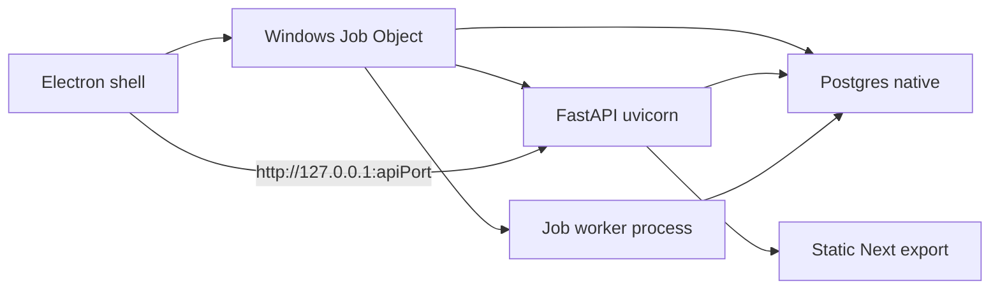

# Bundled native desktop (replace Docker shell)

## Goals

- Non-technical install: double-click installer → open Dhara → use the app (no Docker, WSL, or dependency management).
- Clean break for **0.1.0**: fresh `%LOCALAPPDATA%\Dhara\pgdata`; document that prior Docker-volume data is not imported.
- Optimize for **~8 GB** hosts without blocking install on machines under 8 GB; scale processing limits up on 16 GB+.
- Survive real-world Windows failures: busy ports, stale Postgres lock files, force-killed Electron, and remote support without a console.
- **Upgrade-safe data**: never run schema migrations against the only copy of a user’s DB without a prior backup.
- Do **not** document or name any prior alternate desktop tree; implement in the main [`desktop/`](desktop/) package and rewrite user docs accordingly.

## Target runtime (steady state)

| Role | How it runs |
|------|-------------|
| Postgres | Separate native process (bundled `pgsql`), preferred port **55432** (fallback if busy) |
| API + UI | **One** Python/uvicorn process, preferred port **18000** (fallback if busy); static UI + `/api` + `/mcp` |
| Next.js Node server | **Removed** from desktop runtime |
| Job worker | **Separate** Python process (`python -m app.workers.job_worker`), concurrency **1**; restartable without killing API |
| Child lifetime | All supervised children assigned to a **Windows Job Object** so they die if Electron is force-killed |
| Ollama | Optional host process; never started by first-run setup; **not** in the Job Object (user-installed system service) |

Port **18080** is unused (UI consolidates onto the API port). Do not advertise a third HTTP service.

## Architecture decisions (locked)

1. **Replace** current Docker/WSL desktop under [`desktop/`](desktop/) entirely (no dual runtime).
2. **Serve UI from FastAPI**: desktop frontend build uses Next `output: 'export'`; FastAPI serves the `out/` tree. Electron loads `http://127.0.0.1:<apiPort>` (preferred 18000, or allocated fallback).
3. **Jobs are not inlined into the API process** on desktop. Use a **sibling worker process** so heavy PDF/Excel work cannot freeze or OOM the HTTP server. API keeps `DHARA_INLINE_JOBS` unset/false.
4. **LLM**: cloud/API key is default and recommended; Ollama is Settings opt-in only (`http://127.0.0.1:11434/v1`).
5. **Windows memory**: no `MALLOC_ARENA_MAX`. Use real Windows available-RAM detection and profile-based caps.
6. **RAM preflight**: **warning**, not hard fail, when total RAM &lt; 8 GB. Recommended minimum profile is 8 GB; 16 GB+ enables higher processing limits.
7. **Ports**: try preferred ports; on conflict **allocate a free loopback port**, persist it for the session (and in runtime state), and pass it into Electron/`DATABASE_URL`/window URL. Only surface a hard error if binding truly fails.
8. **Postgres crash recovery**: detect and clear **stale `postmaster.pid`** after unclean shutdown before start.
9. **Privilege**: run Postgres (and other children) as the **normal interactive user** — never elevated; if the shell is elevated, refuse or relaunch unelevated with a clear message (Postgres refuses admin).
10. **Support**: tray (and Settings) actions to **Open logs folder** and **Copy diagnostics**.
11. **Upgrade backups**: before applying Alembic (or any schema-changing startup step) when the installed app/schema version advances, take a **`pg_dump`** (preferred) or a cold **`pgdata` directory copy**; do not migrate if backup fails.
12. **Auth under static export**: no Next middleware; `(protected)` uses **client-side** session checks; **FastAPI JWT** remains the real enforcement. Desktop persists the auth token in **Electron storage** (not origin-scoped `localStorage` alone) so a port fallback does not silently log the user out.
13. **RAM hard gate**: refuse starting a new PDF/heavy extraction job when **available RAM &lt; 1200 MB**, with a plain-English error.
14. **Postgres 8 GB profile**: on first cluster init (and when applying the RAM profile), write explicit low `postgresql.conf` values (`shared_buffers`, `max_connections`, `work_mem`, etc.); raise modestly only on ≥16 GB hosts.
15. **Localhost hardening**: Postgres and API listen on **`127.0.0.1` only**; validate **`Host`** against `127.0.0.1` / `localhost` (+ allocated port); desktop sets **`MCP_HTTP_AUTH=token`** with a **per-install** `MCP_AUTH_TOKEN` (browsers on the same machine must not get open catalogue MCP).

---

## Resolve before / at start of implementation

### A. Dynamic routes → query-param strategy (do this first)

Next static export cannot materialize arbitrary `/…/[jobId]` HTML at build time. FastAPI SPA fallback alone does **not** fix missing exported pages for unknown IDs. Do **not** use `generateStaticParams` for upload-time IDs.

**Approach (locked):** convert data-driven App Router segments to **static paths + query parameters** in the shared frontend.

| Current path | New path |
|--------------|----------|
| `/console/processing/[jobId]` | `/console/processing?jobId=` |
| `/console/review/[jobId]` | `/console/review?jobId=` |
| `/console/grouping/[jobId]` | `/console/grouping?jobId=` |
| `/console/pdf-next-steps/[jobId]` | `/console/pdf-next-steps?jobId=` (or redirect into grouping) |
| `/console/preview/edit/[tableUid]` | `/console/preview/edit?tableUid=` |
| `/console/review/[jobId]/edit/[tableId]` | `/console/review/edit?jobId=&tableId=` |

- Replace dynamic folders under [`frontend/src/app/(protected)/console/`](frontend/src/app/(protected)/console/) with static `page.tsx`; read IDs via `useSearchParams()`.
- Update all `router.push` / links ([`consoleSession.ts`](frontend/src/lib/consoleSession.ts), PDF/console components, etc.).
- Only after routes are static: enable `DHARA_DESKTOP_STATIC=1` → `output: 'export'`, `images.unoptimized: true`.

### B. Job execution isolation (not API-inline)

- Supervisor starts **API** and a **worker** child with the same backend env/`DATABASE_URL` (including whatever PG/API ports were allocated).
- Worker: one job at a time; abnormal exit → restart worker only; API stays up.
- Tray Stop/Start does not wipe `pgdata`.

### C. Windows memory-aware processing

- Extend [`_available_ram_mb()`](backend/app/services/llm_prompts.py) with a **Windows** path (`GlobalMemoryStatusEx` / equivalent).
- **Remove** `MALLOC_ARENA_MAX` from Windows desktop env defaults.
- Profiles: &lt;8 GB warn + 8 GB caps; ~8 GB recommended caps; ≥16 GB higher `PDF_*` caps.
- Job refusal threshold is fixed in **§ J** (**&lt; 1200 MB** available), not a vague “critically low”.

### C2. Postgres memory settings (8 GB profile) — locked values

Write into `pgdata/postgresql.conf` at **first `initdb`** (and re-apply when the desktop RAM profile changes). Prefer appending/overwriting a marked `# dhara-desktop-profile` block so upgrades can refresh safely.

**8 GB / default desktop profile:**

| Setting | Value | Intent |
|---------|--------|--------|
| `listen_addresses` | `127.0.0.1` | Localhost only (also hardening) |
| `shared_buffers` | `128MB` | Small fixed cache on tight RAM |
| `work_mem` | `4MB` | Avoid sort/hash blowups per operation |
| `maintenance_work_mem` | `64MB` | Enough for index/vacuum without hogging |
| `max_connections` | `20` | API + worker + dump + headroom only |
| `effective_cache_size` | `512MB` | Planner hint for 8 GB box |
| `max_wal_size` | `256MB` | Bound WAL growth |
| `checkpoint_completion_target` | `0.9` | Smoother checkpoints |
| `random_page_cost` | `1.1` | Local SSD-ish default |

**≥16 GB profile:** e.g. `shared_buffers=256MB`, `work_mem=8MB`, `maintenance_work_mem=128MB`, `max_connections=40`, `effective_cache_size=2GB` — still conservative for a desktop app sharing the machine.

Also set `port` to the allocated PG port each start (already required for port fallback).

### D. Port conflicts and Postgres lock recovery

**Ports (locked behavior):**

1. Prefer **55432** (Postgres) and **18000** (API/UI).
2. Probe bind on `127.0.0.1`; if preferred port is taken, **allocate an ephemeral free port** (`listen(0)` pattern) and use that for the session.
3. Persist allocated ports in memory for the running app; write last-used ports into `%LOCALAPPDATA%\Dhara\runtime.json` (or equivalent) so logs/diagnostics show them.
4. Electron `loadURL` and all child env (`PORT`, `DATABASE_URL`, `DHARA_STATIC_UI_ROOT`, etc.) must use the **actual** allocated ports—not hardcoded 18000/55432 after fallback.
5. If allocation or listen fails for any other reason: splash shows a **plain-language error** (“Dhara could not open a local network port. Close other apps using that port or restart the PC, then try again.”) plus pointer to Open logs.

**Stale `postmaster.pid` (locked behavior):**

Classic failure after power cut / Task Manager kill: Postgres refuses to start because `pgdata/postmaster.pid` remains.

On start, before `pg_ctl`/`postgres`:

1. If `postmaster.pid` is absent → normal start.
2. If present: read recorded PID (and port if present).
3. If that PID is **alive and is this Postgres** (same data directory / expected image name) → treat as already running or conflict; do not delete the pid file; surface a clear error if we cannot adopt it.
4. If PID is **dead**, or not a postgres process for this data dir → **delete stale `postmaster.pid`** (and `postmaster.opts` if needed per Postgres docs), log the action, then start.
5. Never delete the pid file while a live foreign process still holds the data directory.

Splash copy for unrecoverable PG start: “Dhara could not start its local database. Use Open logs folder and contact support.” Avoid raw `pg_ctl` stderr as the only UI.

### E. Windows Job Object and non-admin Postgres

- Create a Win32 **Job Object** with `JOB_OBJECT_LIMIT_KILL_ON_JOB_CLOSE` (or equivalent) at supervisor start.
- Assign Postgres, uvicorn/API, and worker process handles to that job when spawned so **force-killing Electron** (or job close) reaps orphans and releases `pgdata`.
- Graceful Quit still stops children orderly (worker → API → `pg_ctl stop`), then closes the job.
- **Do not** put a user-installed Ollama service into the Dhara job (it should outlive the app if the user installed it system-wide).
- Detect elevation (`GetTokenInformation` / Electron helper): if running as Administrator, **do not start Postgres**; show “Restart Dhara without Run as administrator” (or auto-relaunch unelevated when feasible). Postgres must run as the normal user.

### F. Logs and supportability

Non-technical users will not use a console. Ship:

| Action | Where | Behavior |
|--------|--------|----------|
| **Open logs folder** | Tray menu (+ Settings help if easy) | `shell.openPath` on `%LOCALAPPDATA%\Dhara\logs` |
| **Copy diagnostics** | Tray menu (+ Settings) | Copy a text blurb to clipboard: app version, OS/build, total/available RAM, allocated ports, `setupComplete`/runtime flags, last error lines from `desktop.log`, whether `postmaster.pid` exists, elevation yes/no |

Logging:

- Supervisor + child stdout/stderr → `%LOCALAPPDATA%\Dhara\logs\` (e.g. `desktop.log`, `postgres.log`, `api.log`, `worker.log`).
- Keep files bounded (simple rotate/truncate) so disks do not fill on long-lived installs.

### G. Data safety on upgrade

A failed **0.1.1+** schema migrate must not destroy a non-technical user’s only catalogue.

**When to backup (locked):**

- Compare stored `dataSchemaVersion` / last-migrated Alembic revision in `%LOCALAPPDATA%\Dhara\runtime.json` (or equivalent) to the revision shipped with the current app.
- If they differ (or first migrate after upgrade of the app binary), **backup first**, then run Alembic.
- Fresh install with empty `pgdata`: skip backup; record schema version after successful migrate.
- Same revision as already applied: skip backup and skip migrate.

**How to backup (locked preference order):**

1. **Disk space gate first:** measure free space on the volume hosting `%LOCALAPPDATA%\Dhara`. Require roughly **≥ 1.5×** current `pgdata` size (or dump estimate + headroom, minimum e.g. **2 GB** free). If insufficient → **do not dump/copy/migrate**; splash: “Not enough free disk space to back up your data before updating. Free some space and try again.”
2. **Preferred:** with Postgres running, run **bundled** `pg_dump.exe` from the same `win-x64/pgsql/bin` as the running server (version-matched — never PATH/`pg_dump` from another install) to  
   `%LOCALAPPDATA%\Dhara\backups\pre-migrate-<appVersion>-<timestamp>.dump`  
   (database `dhara` / catalogue data only).
3. **Fallback** if dump fails: stop Postgres, **copy** entire `pgdata` to  
   `%LOCALAPPDATA%\Dhara\backups\pgdata-pre-migrate-<appVersion>-<timestamp>\`  
   (same disk-space gate applies to the copy), then start again and migrate (or refuse if copy incomplete).

**Secrets in backups (locked):**

- `JWT_SECRET`, `LLM_CREDENTIALS_KEY`, `MCP_AUTH_TOKEN`, and DB passwords live in `%LOCALAPPDATA%\Dhara\runtime.json` (or `.env`) — **not** inside a logical `pg_dump` of app tables. Keep it that way: dump **data only**; do **not** copy `runtime.json` into the backup folder.
- Encrypted LLM API keys **in Postgres** may still appear in the dump (ciphertext). Treat backup files as **sensitive**: write under the user profile with normal ACLs; document “backups contain your Dhara data—do not share the backups folder.”
- Cold **`pgdata` copy** includes DB files but still must **not** bundle `runtime.json`. Restore on the same machine uses the **existing** install secrets file, not secrets from the backup tree.
- Optional later: encrypt dump at rest; **not** required for 0.1.0 if exclusion + ACL + docs are done.

**Failure / retention rules:**

- If disk check or backup fails → **do not run migrations**; splash explains why; point to Open logs.
- If backup succeeds but migrate fails → keep the backup; splash notes backup location; do not delete it.
- Retain the **last 2–3** successful pre-migrate backups; prune older ones.
- Diagnostics should note latest backup path, dump vs pgdata-copy, free disk at backup time, and whether last migrate succeeded.
- Docs: “If an update fails” + do not share/delete `backups\`; secrets stay in `runtime.json`, not in dumps.

**Out of scope for 0.1.0 first ship:** automatic one-click restore UI. Backup gate before Alembic **is** in scope so 0.1.0→0.1.1 is safe.

### G2. Localhost hardening

Any page in the user’s browser can call `http://127.0.0.1:<port>`. Desktop must not expose an open LAN service or open MCP.

**Locked:**

- Postgres: `listen_addresses = '127.0.0.1'` only (see § C2).
- API/uvicorn: bind **`127.0.0.1`** only (never `0.0.0.0`).
- FastAPI: enable **Host header** validation allowing only `127.0.0.1`, `localhost`, and those names with the **actual allocated port** (reject `Host: evil.example` / DNS-rebinding style hosts). Use Starlette `TrustedHostMiddleware` or equivalent.
- **MCP on desktop:** set `MCP_HTTP_AUTH=token` and generate a **per-install** random `MCP_AUTH_TOKEN` stored in `runtime.json` (same lifecycle as `JWT_SECRET`). Do **not** default desktop MCP to `off`. Document that local MCP clients must present that token; normal steward UI does not need open MCP.
- CORS: on desktop prefer the concrete loopback origin `http://127.0.0.1:<apiPort>` (not `allow_origins=["*"]` if that weakens Host checks). Web/Docker can keep current behavior.

### H. Auth under static export (resolve early)

Today there is **no** `middleware.ts`; [`(protected)/layout.tsx`](frontend/src/app/(protected)/layout.tsx) already redirects via client `loggedIn` / `authChecked`, and [`auth.ts`](frontend/src/lib/auth.ts) stores JWT in **`localStorage`**. That pattern is compatible with static export **if**:

1. No new Next middleware or server-only auth is introduced for desktop.
2. Protected layouts keep client guards (redirect to `/login` when no session).
3. FastAPI continues to reject missing/invalid Bearer tokens on protected API routes (UI redirect alone is not security).
4. Static HTML for `/dashboard`, `/console`, etc. may still be downloadable without a token—that is expected for SPA/static; **API** must not return catalogue/job data unauthenticated.

**Verification (required):** *protected routes reject unauthenticated access with the static build* — exercise static UI + API: open a protected page without a token → land on login; call `/api/...` without Bearer → 401; with token → success.

### I. Origin / port fallback and session continuity

`localStorage` / `sessionStorage` are **origin-scoped** (`http://127.0.0.1:18000` ≠ `http://127.0.0.1:18001`). After a port fallback, the user would appear logged out and lose console UI state if auth stayed only in `localStorage`.

**Locked approach for desktop:**

- Persist auth token + user blob via **Electron preload** into `%LOCALAPPDATA%\Dhara\` (preferably `safeStorage`-encrypted), e.g. `dharaDesktop.getAuth` / `setAuth` / `clearAuth`.
- [`auth.ts`](frontend/src/lib/auth.ts): when `window.dharaDesktop` auth APIs exist, use them; otherwise keep `localStorage` for web/Docker.
- On every launch, after the API port is known, inject/restore session into the renderer before loading protected routes (so first paint after port change still sees the user signed in).
- Console `sessionStorage` ephemeral UI state may still reset on origin change—acceptable; auth must not.
- CORS / Host: align with § G2 — concrete loopback origin and Host allowlist using the **actual** allocated port (never hard-code `:18000` only).

### J. Concrete RAM gate

Replace vague “critically low” with a fixed threshold:

| Check | Value | Behavior |
|-------|--------|----------|
| Available RAM (Windows-aware `_available_ram_mb`) | **&lt; 1200 MB** | **Refuse** starting a new PDF (and similarly heavy) job |
| User-facing message | Plain English | e.g. “Your PC does not have enough free memory to process this file right now (need about 1.2 GB free). Close other apps—especially browsers and local AI—and try again.” |
| API | Same gate | Return a clear 4xx/`detail` string the UI can show; do not enqueue then OOM |

Tune constant as `DHARA_MIN_AVAILABLE_RAM_MB` default **1200** so support can override without a rebuild if needed. Excel-only light jobs may use a lower bar later; for 0.1.0 apply the 1.2 GB gate at least to **PDF** extraction paths.

---

## Implementation workstreams

### 1. Frontend routes + static export + auth ([`frontend/`](frontend/))

1. Query-param migration — **blocking** for export.
2. Confirm protected layout stays client-only; wire auth read/write through Electron when present.
3. Desktop prepare: static export into `desktop/resources/win-x64/frontend`.
4. Keep non-desktop web/Docker build path working with the same routes (`localStorage` fallback).

### 2. FastAPI static UI + hardening ([`backend/app/main.py`](backend/app/main.py))

- `DHARA_STATIC_UI_ROOT` for exported tree; never shadow `/api`, `/mcp`, `/.well-known`.
- Desktop: bind 127.0.0.1, Host allowlist, `MCP_HTTP_AUTH=token` + per-install token from env/`runtime.json`.

### 3. Electron shell ([`desktop/`](desktop/))

- Splash → preflight (soft RAM warn, elevation check) → port allocate → secrets (incl. per-install `MCP_AUTH_TOKEN`) → Postgres (pid recovery + **8 GB `postgresql.conf` profile**) → **disk check + bundled `pg_dump` / pgdata backup if schema advanced** → Alembic → record schema version → API (127.0.0.1 + Host allowlist) → worker → `loadURL` with actual API port.
- Job Object wrapping for children; tray; hide-on-close; upload IPC; auth IPC (`getAuth`/`setAuth`/`clearAuth` via `safeStorage`); **Open logs** / **Copy diagnostics**.
- Remove Docker/WSL/compose/image-tar flow.

### 4. First-run / LLM UX

- No Ollama during setup; cloud recommended; Settings opt-in for local models.

### 5. Packaging

- fetch/prepare/build-installer + pgvector gate; NSIS keep-data default; wipe = stop processes + delete `%LOCALAPPDATA%\Dhara`.

### 6. Docs

- Bundled runtime, soft RAM guidance, optional Ollama, clean-break from Docker volumes, troubleshooting for ports / stale database lock / “don’t Run as administrator”, how to send diagnostics, **what happens on update** (automatic backup under `%LOCALAPPDATA%\Dhara\backups`; do not share/delete that folder; secrets stay in `runtime.json`), and that MCP needs the per-install token on desktop.

## Verification

- Preferred ports free → uses 55432 / 18000; with 18000 occupied → falls back, UI still loads on new port.
- Kill Electron via Task Manager → no orphaned `postgres.exe` holding `pgdata`; next launch starts cleanly.
- Simulate stale `postmaster.pid` (dead PID) → auto-recover and start; live foreign lock → clear error, no silent delete.
- Launch elevated → Postgres does not start; user sees unelevated guidance.
- Tray **Copy diagnostics** pastes usable support text; **Open logs folder** opens Explorer.
- Kill worker mid-job → API stays up; worker can restart.
- Query-param navigation + static export; soft &lt;8 GB warning; no `MALLOC_ARENA_MAX` on Windows env.
- Ollama only after explicit Settings action; web/Docker path still builds.
- Simulate schema bump: backup appears under `backups\` **before** migrate; forced backup failure → migrate skipped and splash explains why; forced migrate failure → prior dump/`pgdata` copy still present.
- **Protected routes reject unauthenticated access with the static build** (UI → login; API → 401 without Bearer).
- Start on 18000, sign in, quit; restart with 18000 occupied so API binds another port → user still signed in via Electron-stored token (not stranded by origin change).
- With available RAM forced below **1200 MB**, PDF upload/start returns the plain-English insufficient-memory message and does not start the job.
- Fresh `pgdata`: `postgresql.conf` contains the 8 GB profile (`shared_buffers=128MB`, `max_connections=20`, `work_mem=4MB`, etc.); API/Postgres not reachable off loopback; `Host: evil.test` rejected; `/mcp` without token → 401; with per-install token → OK.
- Backup uses `win-x64/pgsql/bin/pg_dump.exe` (not PATH); low free disk → no migrate; `runtime.json` / JWT secrets not copied into `backups\`.
