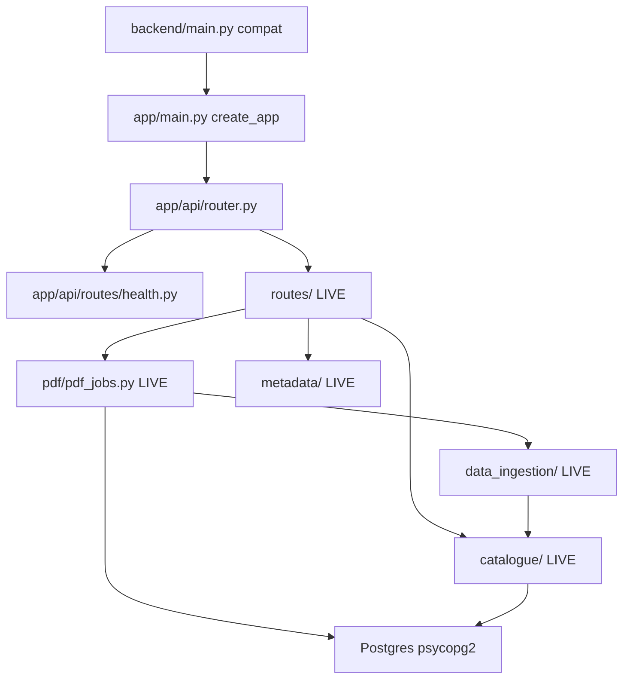

# Dhara Backend Architecture

This document describes the target layered layout under `backend/app/`, how
it maps to the **live** modules that still run production traffic, and the
agreed migration order.

## Process entry

| Entry | Command / path | Status |
|-------|----------------|--------|
| API (compat) | `uvicorn main:app` from `backend/` (`run.sh`, `start.sh`, Docker) | **Live** — re-exports `app.main.app` |
| App factory | `app/main.py` (`create_app`) | **Live** |
| Router aggregation | `app/api/router.py` | **Live** — mounts existing `routes/*` |
| MCP stdio | `python -m mcp_server` | **Live** |
| MCP HTTP | Mounted at `/mcp` on the same FastAPI app | **Live** |

Deployment commands keep using `main:app`. Domain handlers still live under
`backend/routes/` until later phases move them.

## Layer purposes

| Layer | Responsibility |
|-------|----------------|
| **API routes** | HTTP, validation, status codes, auth dependencies. Call services. No substantial business logic or inline SQL. |
| **Services** | Domain workflows and rules. Coordinate repositories, storage, and other services. No FastAPI request objects. No embedded DB connection config. |
| **Repositories** | Queries and persistence. Accept a session/connection. No HTTP. |
| **Schemas** | Public request/response models, separate from ORM tables. |
| **Core** | Config, security primitives, permissions, shared exceptions, logging. |
| **Storage** | File and vector interfaces (local FS, object store, pgvector). |
| **Workers** | Background jobs outside the request lifecycle. |
| **MCP** | Agent-facing tools (mirror published catalogue access). |

## Dependency direction

```text
API routes
    ↓
Services
    ↓
Repositories / Storage interfaces
    ↓
Database / Filesystem / Object storage
```

Domain services may call other services through clear interfaces.
Infrastructure must not import API routes.



## Current application facts (must preserve)

- Schema is **request-time DDL** via `catalogue.db.init_schema()`, not
  startup migrations. `/api/ready` and `/api/health` are read-only.
- No organisations or RBAC yet. `users.email` is the PK; JWT `sub` is email.
  Isolation is ad hoc `user_email` filters; published catalogue reads are
  global to any authenticated user.
- PostgreSQL-specific features in use: JSONB, `TEXT[]`, `BYTEA`,
  `ON CONFLICT`, `ILIKE`, `TIMESTAMPTZ`, optional pgvector.
- PDF jobs: in-memory `_pdf_jobs` plus Postgres `pdf_jobs` (incl. `pdf_bytes`).
- Two Excel paths: upload (`data_ingestion/excel.py` + shared validation) vs
  catalogue wizard (`catalogue/extract/extractor.py`). Different contracts.
- `data_ingestion/pdf/confidence_validation/` is the **shared** upload
  validator for PDF, Excel, and CSV (`PreValidationInput`).
- `backend/config.py` holds LLM prompts/worker counts — not app settings.
- Storage: PDF in BYTEA; optional GCS via `core/gcs_utils.py`.
- Auth gaps: `ENABLE_SIGNUP` default on; `MCP_HTTP_AUTH` default `off`.
- Eager import: `data_ingestion/__init__.py` pulls the PDF pipeline.
  New packages must not re-export that graph from `__init__.py`.

## Placeholders vs live modules

### App package (Phase 2 — live factory)

| Module | Role |
|--------|------|
| `app/main.py` | `create_app()`, lifespan, CORS, MCP mount, SPA |
| `app/api/router.py` | Includes health + all live `routes/*` routers |
| `app/api/routes/health.py` | `/api/live`, `/api/ready`, `/api/health` |
| `app/api/dependencies.py` | Re-exports `core.deps` helpers |

Other `app/` packages (services, db, storage, workers) remain docstring
placeholders until later phases. `backend/migrations/README.md` still
documents that Alembic is not configured yet.

### Still live (do not delete; keep imports working)

| Area | Live modules |
|------|----------------|
| Compat entry | `main.py` (re-exports `app.main.app`) |
| HTTP routes | `routes/auth.py`, `kyds.py`, `llm_key.py`, `catalogue.py`, `pdf.py`, `upload.py`, `dashboard.py`, `access.py` |

| Auth / deps / GCS / vectors | `core/auth.py`, `core/deps.py`, `core/gcs_utils.py`, `core/vector_store.py` |
| Catalogue domain | `catalogue/*` |
| PDF jobs / store / grouping | `pdf/pdf_jobs.py`, `pdf_store.py`, `pdf_grouping.py` |
| Upload ingest | `data_ingestion/*` |
| Metadata fill / validation | `metadata/*` |
| MCP | `mcp_server/*` |
| Prompt config | `config.py` |
| Docker pgvector init | `db/init-pgvector.sql` |
| Tests / scripts | `tests/`, `scripts/` |

### Modules without a 1:1 target folder

| Concern | Live location | Target notes |
|---------|---------------|--------------|
| KYDS | `routes/kyds.py`, `catalogue/kyds.py` | Keep `kyds_entries` table; service under auth/settings or dedicated KYDS service later |
| Dashboard | `routes/dashboard.py`, `catalogue/dashboard.py` | Often folds into datasets + jobs status |
| Access API v1 | `routes/access.py` | Published catalogue query surface |
| Metadata wizard | `metadata/*` | Between catalogue extract and publish |
| MCP | `mcp_server/` | `app/mcp/` later |

## Name collisions

| Path | Meaning |
|------|---------|
| `backend/config.py` | LLM prompts / worker constants |
| `app/core/config.py` | Future env-driven app settings |
| `backend/core/` | Live auth, deps, GCS, vectors |
| `app/core/` | Target shared core |
| `backend/db/` | Docker SQL init |
| `app/db/` | Target ORM / sessions / repositories |
| `backend/pdf/` | Jobs, store, grouping |
| `data_ingestion/pdf/` | Extraction + confidence validation |

## Current → target file mapping

| Live | Target (eventual) |
|------|-------------------|
| `main.py` | `app/main.py` + thin compat `main.py` |
| `routes/*.py` | `app/api/routes/*.py` via `app/api/router.py` |
| `core/deps.py` | `app/api/dependencies.py` |
| `core/auth.py` | `app/core/security.py` + `services/auth` |
| `catalogue/db.py` | `app/db/session.py`, models, repositories |
| `catalogue/users.py` | `services/auth` + user repository |
| `catalogue/kyds.py` | KYDS repository/service; table stays `kyds_entries` |
| `catalogue/datasets.py`, `query.py` | `services/datasets`, `services/catalogue` |
| `catalogue/classifications.py`, `nco_*` | `services/classification` |
| `catalogue/classification_standards.py` | `services/standards` |
| `catalogue/catalogue_matching.py`, `pdf/pdf_grouping.py` | `services/grouping` |
| `data_ingestion/pipeline.py` | `services/ingestion/service.py` |
| `data_ingestion/utils/types.py` | `services/ingestion/contracts.py` |
| `data_ingestion/{pdf,excel,csv}` | `services/ingestion/adapters/*` |
| `data_ingestion/pdf/confidence_validation/` | `services/extraction/` (shared validation) |
| `pdf/pdf_jobs.py` | `app/workers/jobs.py` |
| `core/gcs_utils.py` | `app/storage/object_store.py` |
| `core/vector_store.py` | `app/storage/vectors.py` |
| `mcp_server/` | `app/mcp/` |

## Account data (decided)

| Data | Storage | Notes |
|------|---------|-------|
| Login profile | `users` | `email` PK, `password_hash`, `name`, `dept` |
| Session | Browser `localStorage` + JWT | No sessions table yet |
| KYDS | `kyds_entries` | Separate table. `POST` create, `GET /api/kyds/mine`, `PATCH /api/kyds/{id}` |
| LLM API key | `llm_api_keys` | **Separate table**, one row per user. `GET`/`POST /api/llm-key`. Header `X-Llm-Api-Key` overrides; absent header uses stored key |
| Dataset-id / metadata UI prefs | Browser `localStorage` today | Future `organisation_settings` if shared |
| UI role labels | Not durable | Future `organisation_memberships.role` |
| Classification standards | `classification_standards` (+ codes, active `nco_2015_codes`) | |

Neither KYDS nor LLM keys are columns on `users`.

## Deferred decisions

- Additive organisation / membership tables without rewriting email PKs in place.
- Move shared validation under extraction (ownership rename) without breaking imports.
- Keep both Excel extractors until contracts are unified deliberately.
- pgvector remains optional / explicitly managed.
- No automatic migration on every API startup.
- MCP auth default stays until Phase 4 hardens it.
- Alembic baseline must include additive tables (`llm_api_keys`, etc.) without drops.

## Proposed migration order

1. ~~**Phase 2** — App factory mounting existing routers~~ **done**
2. ~~**Account data slice** — `llm_api_keys` + KYDS `PATCH`~~ **done**
3. **Phase 3** — SQLAlchemy 2 + Alembic baseline mirroring current tables; remove request-time DDL once migrations are safe.
4. **Phase 4** — Auth: stable user id in JWT `sub`, roles, tenant isolation in services/repositories.
5. **Phase 5** — Ingestion/extraction adapters as wrappers, then careful moves; preserve grouping after approval.
6. **Phase 6** — FileStorage / VectorStore interfaces; durable job state.
7. **Phase 7** — Deployment docs; Postgres-first portability policy.
8. **Phase 8** — Broader test matrix and quality gates.

## Phase 1 status

- [x] `backend/app/` package tree with docstring placeholders
- [x] `backend/migrations/README.md` (Alembic not configured yet)
- [x] This document

## Phase 2 status

- [x] `app/main.py` — `create_app()` with lifespan, CORS, MCP, SPA
- [x] `app/api/router.py` — mounts live `routes/*` + health
- [x] `app/api/routes/health.py` — liveness/readiness (no secrets, no DDL)
- [x] `app/api/dependencies.py` — re-exports `core.deps`
- [x] `backend/main.py` — compatibility entry (`load_dotenv` + re-export)
- Domain HTTP handlers remain in `backend/routes/` (heavy logic not peeled yet)

## Account data slice (implemented on live modules)

Additive DDL in `catalogue.db.init_schema()` (no drops):

- Table `llm_api_keys` — `routes/llm_key.py` (`GET`/`POST /api/llm-key`);
  `catalogue/llm_keys.py`; `core.deps.resolve_llm_credentials` uses stored key
  when `X-Llm-Api-Key` is absent.
- `kyds_entries.updated_at` + `PATCH /api/kyds/{entry_id}` in `routes/kyds.py`;
  frontend edits use PATCH instead of creating a new row.
