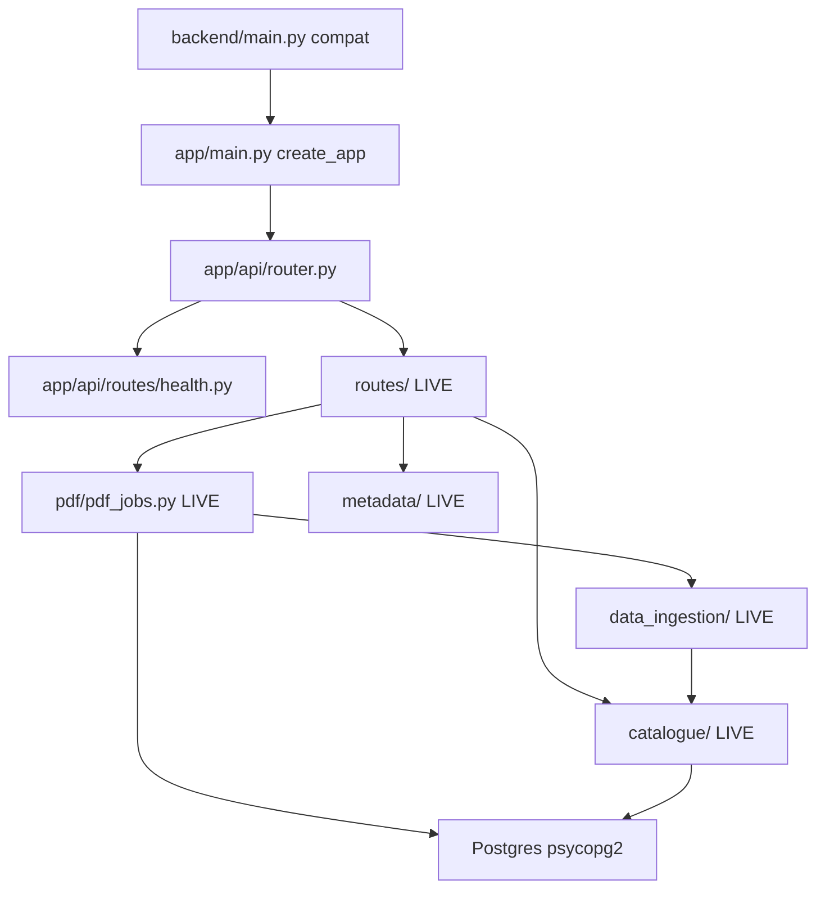

# Dhara Backend Architecture

This document describes the target layered layout under `backend/app/`, how
it maps to the **live** modules that still run production traffic, and the
agreed migration order.

## Process entry

| Entry | Command / path | Status |
|-------|----------------|--------|
| API (compat) | `uvicorn main:app` from `backend/` (`run.sh`, `start.sh`, Docker) | **Live** — re-exports `app.main.app` |
| App factory | `app/main.py` (`create_app`) | **Live** |
| Router aggregation | `app/api/router.py` | **Live** — mounts existing `routes/*` |
| MCP stdio | `python -m mcp_server` | **Live** |
| MCP HTTP | Mounted at `/mcp` on the same FastAPI app | **Live** |

Deployment commands keep using `main:app`. Domain handlers still live under
`backend/routes/` until later phases move them.

## Layer purposes

| Layer | Responsibility |
|-------|----------------|
| **API routes** | HTTP, validation, status codes, auth dependencies. Call services. No substantial business logic or inline SQL. |
| **Services** | Domain workflows and rules. Coordinate repositories, storage, and other services. No FastAPI request objects. No embedded DB connection config. |
| **Repositories** | Queries and persistence. Accept a session/connection. No HTTP. |
| **Schemas** | Public request/response models, separate from ORM tables. |
| **Core** | Config, security primitives, permissions, shared exceptions, logging. |
| **Storage** | File and vector interfaces (local FS, object store, pgvector). |
| **Workers** | Background jobs outside the request lifecycle. |
| **MCP** | Agent-facing tools (mirror published catalogue access). |

## Dependency direction

```text
API routes
    ↓
Services
    ↓
Repositories / Storage interfaces
    ↓
Database / Filesystem / Object storage
```

Domain services may call other services through clear interfaces.
Infrastructure must not import API routes.



## Current application facts (must preserve)

- Schema baseline: **Alembic** under `backend/migrations/` (revision 001).
  Request-time DDL via `catalogue.db.init_schema()` remains until
  `DISABLE_REQUEST_TIME_DDL=true` (default `false` for local/dev without
  Alembic). `/api/ready` and `/api/health` stay read-only (no DDL).
- **Default organisation** (`DEFAULT_ORGANISATION_SLUG=default`) with
  `organisation_memberships` (`administrator` | `data_steward` | `data_user`).
  `users.email` remains PK; additive `users.id` UUID is unique. JWT `sub` is
  the user UUID (breaking: clients must re-login). Optional JWT claim `email`
  is informational only.
- Tenant isolation: `organisation_id` on PDF jobs, catalogue datasets/groups,
  KYDS, embeddings, staging, etc. Published catalogue **Access API**
  (`/api/v1/*`) filters by the caller's organisation (no longer global
  published read across orgs).
- PostgreSQL-specific features: JSONB, `TEXT[]`, `BYTEA`, `ON CONFLICT`,
  `ILIKE`, `TIMESTAMPTZ`, optional pgvector / HNSW (Postgres-only).
- PDF jobs: in-memory `_pdf_jobs` plus Postgres `pdf_jobs` (incl. `pdf_bytes`).
- Two Excel paths (intentionally separate): upload
  (`data_ingestion/excel.py` + shared validation) vs catalogue wizard
  (`catalogue/extract/extractor.py`).
- Shared upload validator lives at
  `app/services/extraction/pdf/confidence_validation/` with shims under
  `data_ingestion/pdf/confidence_validation/`. Contracts:
  `app/services/ingestion/contracts.py` (`PreValidationInput`).
- `app/core/config.py` — env settings (`DATABASE_URL`, JWT, org slug, DDL flag).
  `backend/config.py` — LLM prompts/worker counts only.
- Storage: PDF in BYTEA; optional GCS via `core/gcs_utils.py`.
- Auth gaps remaining: `ENABLE_SIGNUP` default on; `MCP_HTTP_AUTH` default `off`
  (optional JWT when enabled; tools should respect org when JWT present).
- Eager import: `data_ingestion/__init__.py` pulls the PDF pipeline.
  Contracts must not import the pipeline graph from `__init__.py`.

## Placeholders vs live modules

### App package (Phases 2–5 — live)

| Module | Role |
|--------|------|
| `app/main.py` | `create_app()`, lifespan, CORS, MCP mount, SPA |
| `app/api/router.py` | Health + auth/KYDS/LLM (app routes) + remaining `routes/*` |
| `app/api/routes/health.py` | `/api/live`, `/api/ready`, `/api/health` |
| `app/api/routes/auth.py` | Login / signup / `/api/me` via `AuthService` |
| `app/api/routes/kyds.py`, `llm_key.py` | Account settings (org-aware) |
| `app/api/dependencies.py` | `CurrentUser`, UUID JWT `require_user` |
| `app/core/config.py`, `security.py` | Settings + bcrypt/JWT |
| `app/db/` | SQLAlchemy `Base`, session, models, repositories |
| `app/services/auth/` | Signup / login / session profile |
| `app/services/ingestion/` | Upload pipeline + adapters + contracts |
| `app/services/extraction/` | Shared confidence validation (moved) |
| `migrations/` | Alembic env + revision 001 |

### Still live (do not delete; keep imports working)

| Area | Live modules |
|------|----------------|
| Compat entry | `main.py` (re-exports `app.main.app`) |
| HTTP routes | `routes/auth.py` / `kyds.py` / `llm_key.py` are **re-exports**; `catalogue.py`, `pdf.py`, `upload.py`, `dashboard.py`, `access.py` still hold heavy handlers |
| Auth / deps / GCS / vectors | `core/auth.py`, `core/deps.py` (compat shims), `core/gcs_utils.py`, `core/vector_store.py` |
| Catalogue domain | `catalogue/*` (psycopg2; DDL gated) |
| PDF jobs / store / grouping | `pdf/pdf_jobs.py`, `pdf_store.py`, `pdf_grouping.py` |
| Upload ingest | `data_ingestion/*` (pipeline/types/confidence_validation → shims) |
| Metadata fill / validation | `metadata/*` |
| MCP | `mcp_server/*` |
| Prompt config | `config.py` |
| Docker pgvector init | `db/init-pgvector.sql` |
| Tests / scripts | `tests/`, `scripts/create_user.py` (membership-aware) |

### Modules without a 1:1 target folder

| Concern | Live location | Target notes |
|---------|---------------|--------------|
| KYDS | `routes/kyds.py`, `catalogue/kyds.py` | Keep `kyds_entries` table; service under auth/settings or dedicated KYDS service later |
| Dashboard | `routes/dashboard.py`, `catalogue/dashboard.py` | Often folds into datasets + jobs status |
| Access API v1 | `routes/access.py` | Published catalogue query surface |
| Metadata wizard | `metadata/*` | Between catalogue extract and publish |
| MCP | `mcp_server/` | `app/mcp/` later |

## Name collisions

| Path | Meaning |
|------|---------|
| `backend/config.py` | LLM prompts / worker constants |
| `app/core/config.py` | Future env-driven app settings |
| `backend/core/` | Live auth, deps, GCS, vectors |
| `app/core/` | Target shared core |
| `backend/db/` | Docker SQL init |
| `app/db/` | Target ORM / sessions / repositories |
| `backend/pdf/` | Jobs, store, grouping |
| `data_ingestion/pdf/` | Extraction + confidence validation |

## Current → target file mapping

| Live | Target (eventual) |
|------|-------------------|
| `main.py` | `app/main.py` + thin compat `main.py` |
| `routes/*.py` | `app/api/routes/*.py` via `app/api/router.py` |
| `core/deps.py` | `app/api/dependencies.py` |
| `core/auth.py` | `app/core/security.py` + `services/auth` |
| `catalogue/db.py` | `app/db/session.py`, models, repositories |
| `catalogue/users.py` | `services/auth` + user repository |
| `catalogue/kyds.py` | KYDS repository/service; table stays `kyds_entries` |
| `catalogue/datasets.py`, `query.py` | `services/datasets`, `services/catalogue` |
| `catalogue/classifications.py`, `nco_*` | `services/classification` |
| `catalogue/classification_standards.py` | `services/standards` |
| `catalogue/catalogue_matching.py`, `pdf/pdf_grouping.py` | `services/grouping` |
| `data_ingestion/pipeline.py` | `services/ingestion/service.py` |
| `data_ingestion/utils/types.py` | `services/ingestion/contracts.py` |
| `data_ingestion/{pdf,excel,csv}` | `services/ingestion/adapters/*` |
| `data_ingestion/pdf/confidence_validation/` | `services/extraction/` (shared validation) |
| `pdf/pdf_jobs.py` | `app/workers/jobs.py` |
| `core/gcs_utils.py` | `app/storage/object_store.py` |
| `core/vector_store.py` | `app/storage/vectors.py` |
| `mcp_server/` | `app/mcp/` |

## Account data (decided)

| Data | Storage | Notes |
|------|---------|-------|
| Login profile | `users` | `email` PK, additive `id` UUID, `password_hash`, `name`, `dept` |
| Organisation | `organisations` + `organisation_memberships` | Default org backfill; role on membership |
| Session | Browser `localStorage` + JWT (`sub` = user UUID) | No sessions table; re-login after upgrade |
| KYDS | `kyds_entries` | Separate table + `organisation_id`. `POST` / `GET /api/kyds/mine` / `PATCH` |
| LLM API key | `llm_api_keys` | One row per user. `GET`/`POST /api/llm-key`. Header overrides stored key |
| Dataset-id / metadata UI prefs | Browser `localStorage` today | Future `organisation_settings` if shared |
| Classification standards | `classification_standards` (+ codes, active `nco_2015_codes`) | |

Neither KYDS nor LLM keys are columns on `users`.

## Deferred decisions

- Full migration of `routes/catalogue.py` off psycopg2 / request DDL.
- Unify the two Excel extractors (explicit non-goal of Phases 3–5).
- Phase 6 storage/jobs queue; Phase 7 `DEPLOYMENT.md`.
- Harden MCP auth default (`MCP_HTTP_AUTH`).
- Promote `users.id` to PK and rewrite FKs off `email` (separate wave).

## Proposed migration order

1. ~~**Phase 2** — App factory mounting existing routers~~ **done**
2. ~~**Account data slice** — `llm_api_keys` + KYDS `PATCH`~~ **done**
3. ~~**Phase 3** — SQLAlchemy 2 + Alembic baseline; `DISABLE_REQUEST_TIME_DDL` gate~~ **done**
4. ~~**Phase 4** — UUID JWT `sub`, default org, tenant filters, auth/KYDS/LLM app routes~~ **done**
5. ~~**Phase 5** — Ingestion/extraction services + confidence_validation move + shims~~ **done**
6. **Phase 6** — FileStorage / VectorStore interfaces; durable job state.
7. **Phase 7** — Deployment docs; Postgres-first portability policy.
8. **Phase 8** — Broader test matrix and quality gates.

## Phase 1 status

- [x] `backend/app/` package tree with docstring placeholders
- [x] `backend/migrations/README.md` (Alembic configured; see Phases 3–5)
- [x] This document

## Phase 2 status

- [x] `app/main.py` — `create_app()` with lifespan, CORS, MCP, SPA
- [x] `app/api/router.py` — mounts live `routes/*` + health
- [x] `app/api/routes/health.py` — liveness/readiness (no secrets, no DDL)
- [x] `app/api/dependencies.py` — `CurrentUser` + UUID JWT (Phase 4)
- [x] `backend/main.py` — compatibility entry (`load_dotenv` + re-export)

## Account data slice (implemented on live modules)

Additive DDL in `catalogue.db.init_schema()` / Alembic 001 (no drops):

- Table `llm_api_keys` — `app/api/routes/llm_key.py` (`GET`/`POST /api/llm-key`)
- `kyds_entries.updated_at` + `PATCH /api/kyds/{entry_id}`

## Phases 3–5 status

- [x] SQLAlchemy 2 + Alembic (`migrations/versions/001_baseline_orgs_tenant.py`)
- [x] `app/core/config.py`, `app/db/session.py`, ORM models, repositories
- [x] Default organisation backfill + membership roles
- [x] JWT `sub` = user UUID; `AuthService`; app auth/KYDS/LLM routes
- [x] Tenant filters on PDF jobs, dashboard, Access API, KYDS
- [x] `DISABLE_REQUEST_TIME_DDL` gate on `init_schema`
- [x] Ingestion service + adapters; extraction service; confidence_validation move + shims
- [x] Targeted tests: `tests/test_auth_jwt.py`, `tests/test_tenant_isolation.py`
