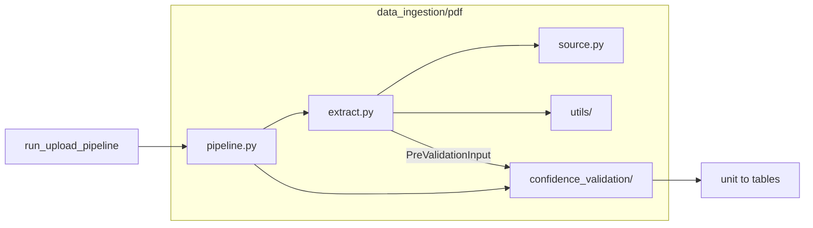

# PDF upload — step 1 (before grouping)

Start here when reading this package. Grouping and catalogue publish are **step 2**
(`pdf/pdf_grouping.py` via `POST …/persist-approved`) and are not in this folder.

## Start here

| File | Role |
|------|------|
| [`pipeline.py`](pipeline.py) | **Upload entry** — `run_pdf_upload_pipeline` |
| [`source.py`](source.py) | Validate PDF path / suffix |
| [`extract.py`](extract.py) | PyMuPDF extract → **`PreValidationInput`** |
| [`utils/`](utils/) | Physical extraction only (`pymupdf`, `workers`, `dual_column`, `header_utils`) |
| [`confidence_validation/`](confidence_validation/) | Confidence split + LLM reconstruction + guards |

### Inside `confidence_validation/`

| Module | Role |
|--------|------|
| `orchestrate.py` | `run_post_extraction_validation` / `run_pipeline` |
| `confidence_split.py` | High vs needs-LLM buckets |
| `heuristic.py` | Accept grids when no LLM key / empty LLM |
| `llm.py` | Batched reconstruct + classify prompts/API |
| `alignment.py` / `normalize.py` / `stamp.py` | Post-LLM guards and structure attach |
| `table_confidence.py` | Page classifier + title inference |
| `dev_cli.py` | Optional local CLI (`python -m data_ingestion.pdf`) |

## Flow

```text
POST /api/upload (type=pdf)
  → run_upload_pipeline
    → data_ingestion.pdf.pipeline.run_pdf_upload_pipeline
        → extract.extract_pdf_to_pre_input   # PreValidationInput
        → confidence_validation.run_post_extraction_validation
            → confidence split (high vs needs LLM)
            → LLM / heuristic tables
        → tag source_type=pdf
  → job.result  { page → { tables: [...] } }
```



## `PreValidationInput`

Built by [`extract.py`](extract.py):

- `pages_grouped` — page → list of grid candidates (`df`, `method`, `bbox`, …)
- `unit_context` — page → raw page text
- `source_type` / `source_file` / `source_path` / `outline_index`

Consumed by [`confidence_validation/`](confidence_validation/).

## Dev CLI (optional)

```bash
cd backend && python -m data_ingestion.pdf --pages 1-3
```
